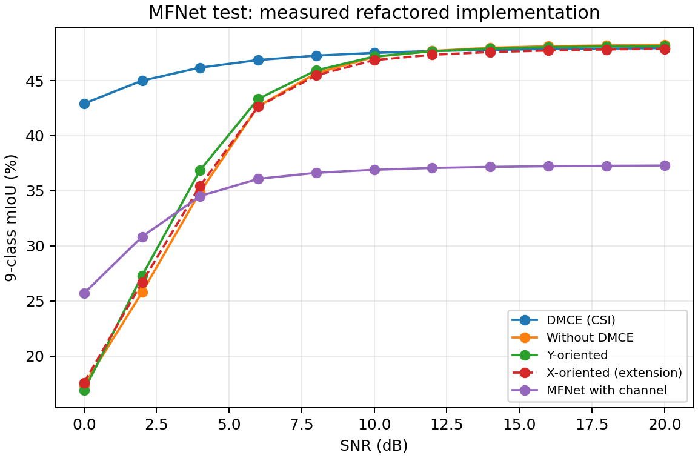
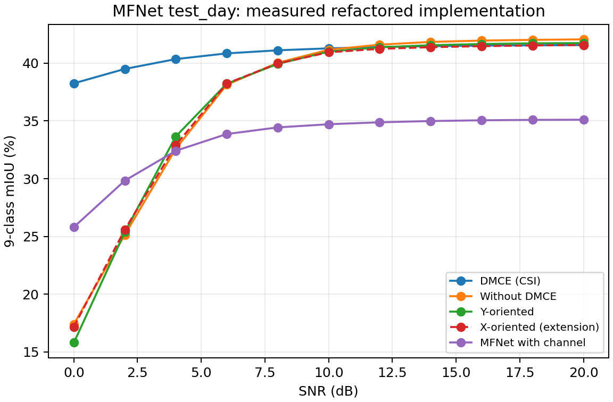
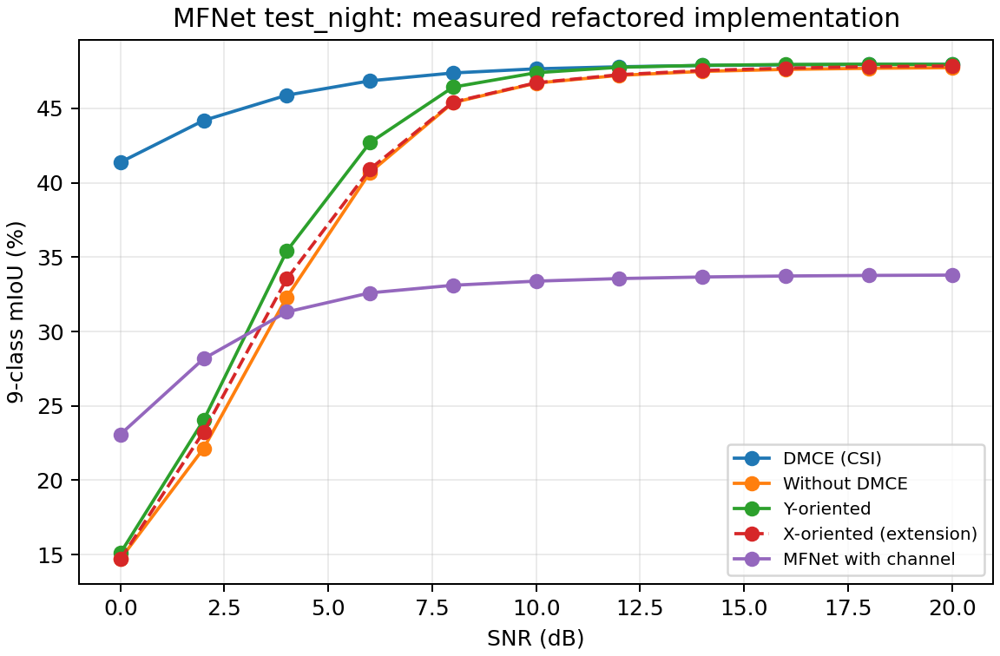
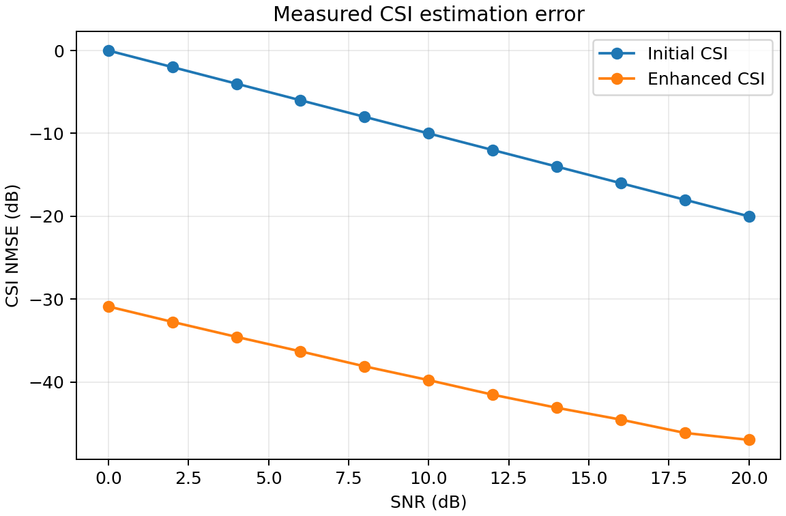
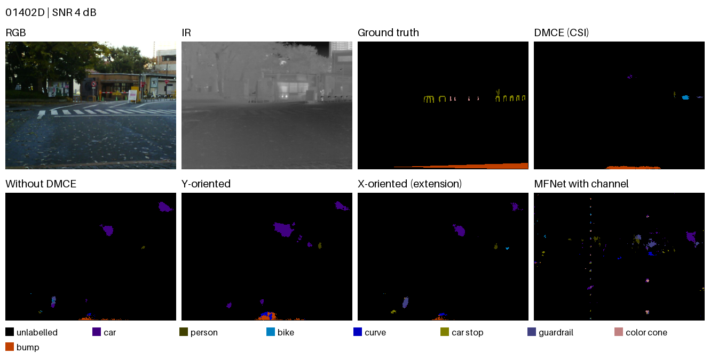
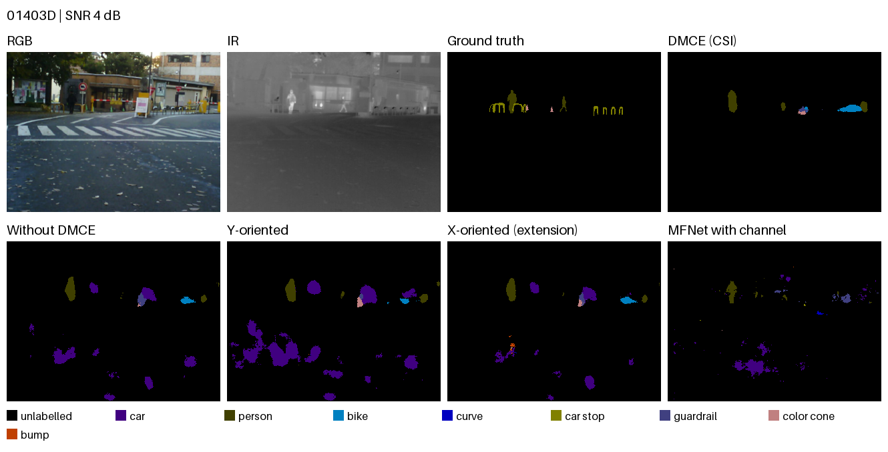
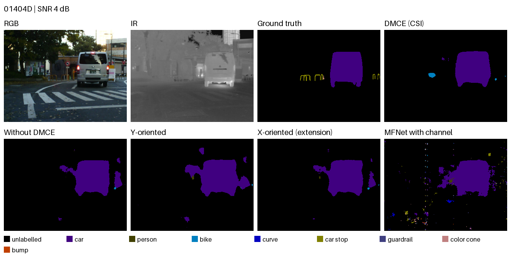
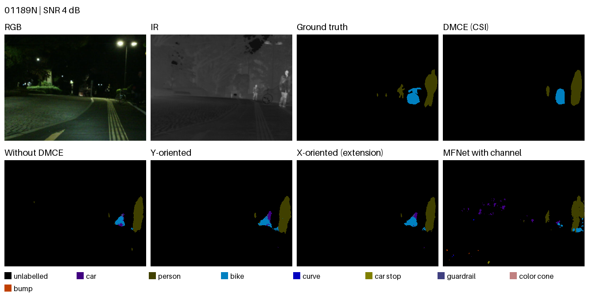
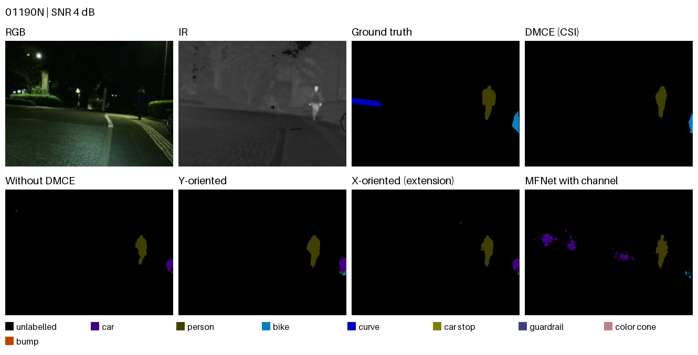

# Measured experiment results

[English](README.md) | [简体中文](README.zh-CN.md)

This report is generated from the measured JSON/CSV artifacts in this directory. Values are from the corrected legacy implementation, not copied from the ICC 2024 paper.

Protocol: `full_mfnet_100_epochs`. Seed: **42**. Test scenes: **393** (**205** day, **188** night). Models are selected by validation performance; test scores do not select checkpoints.

This is a single-seed run without confidence intervals. It retains the simplified shared elementwise channel, synthetic diffusion training data, and deterministic adjacent-step sampler. It does not establish the paper's full MIMO results or published percentage gains. The X-oriented method is a legacy extension.

All/day/night are separate evaluation passes with reset random seeds. Channel draws and batch-average noise power can therefore differ between passes; the day/night confusion matrices are not partitions of a single all-test pass.

## All test scenes

Nine-class mIoU (%); the background class is included.

| SNR (dB) | DMCE (CSI) | Without DMCE | Y-oriented | X-oriented (extension) | MFNet with channel |
| --- | --- | --- | --- | --- | --- |
| 0 | 42.92 | 17.35 | 16.88 | 17.59 | 25.70 |
| 2 | 45.00 | 25.79 | 27.31 | 26.70 | 30.84 |
| 4 | 46.18 | 34.90 | 36.88 | 35.45 | 34.52 |
| 6 | 46.87 | 42.67 | 43.34 | 42.64 | 36.08 |
| 8 | 47.27 | 45.67 | 45.93 | 45.48 | 36.63 |
| 10 | 47.52 | 47.15 | 47.19 | 46.86 | 36.90 |
| 12 | 47.68 | 47.69 | 47.67 | 47.35 | 37.07 |
| 14 | 47.79 | 47.98 | 47.91 | 47.59 | 37.17 |
| 16 | 47.86 | 48.12 | 48.04 | 47.73 | 37.23 |
| 18 | 47.91 | 48.19 | 48.11 | 47.82 | 37.27 |
| 20 | 47.94 | 48.25 | 48.14 | 47.89 | 37.29 |

## Day scenes

Nine-class mIoU (%); the background class is included.

| SNR (dB) | DMCE (CSI) | Without DMCE | Y-oriented | X-oriented (extension) | MFNet with channel |
| --- | --- | --- | --- | --- | --- |
| 0 | 38.26 | 17.40 | 15.81 | 17.18 | 25.81 |
| 2 | 39.50 | 25.15 | 25.38 | 25.59 | 29.84 |
| 4 | 40.35 | 32.59 | 33.66 | 32.90 | 32.42 |
| 6 | 40.85 | 38.13 | 38.22 | 38.23 | 33.87 |
| 8 | 41.11 | 40.03 | 39.93 | 39.97 | 34.44 |
| 10 | 41.28 | 41.16 | 41.00 | 40.94 | 34.71 |
| 12 | 41.40 | 41.60 | 41.37 | 41.24 | 34.88 |
| 14 | 41.47 | 41.84 | 41.55 | 41.38 | 34.99 |
| 16 | 41.52 | 41.95 | 41.66 | 41.47 | 35.06 |
| 18 | 41.55 | 42.02 | 41.72 | 41.53 | 35.09 |
| 20 | 41.57 | 42.06 | 41.74 | 41.57 | 35.10 |

## Night scenes

Nine-class mIoU (%); the background class is included.

| SNR (dB) | DMCE (CSI) | Without DMCE | Y-oriented | X-oriented (extension) | MFNet with channel |
| --- | --- | --- | --- | --- | --- |
| 0 | 41.39 | 14.71 | 15.10 | 14.69 | 23.09 |
| 2 | 44.19 | 22.14 | 24.04 | 23.26 | 28.17 |
| 4 | 45.89 | 32.31 | 35.41 | 33.53 | 31.32 |
| 6 | 46.86 | 40.69 | 42.70 | 40.92 | 32.60 |
| 8 | 47.39 | 45.39 | 46.43 | 45.43 | 33.11 |
| 10 | 47.67 | 46.71 | 47.40 | 46.73 | 33.39 |
| 12 | 47.80 | 47.23 | 47.77 | 47.27 | 33.56 |
| 14 | 47.89 | 47.49 | 47.90 | 47.55 | 33.67 |
| 16 | 47.93 | 47.63 | 47.96 | 47.71 | 33.73 |
| 18 | 47.95 | 47.70 | 47.97 | 47.81 | 33.77 |
| 20 | 47.96 | 47.74 | 47.96 | 47.86 | 33.79 |

At 0 dB, DMCE measured 42.92% versus 17.35% without DMCE, a difference of **+25.57 percentage points** in this run. This is an absolute difference, not a relative percentage improvement.

## Per-class IoU at 4 dB

| Class | DMCE (CSI) | Without DMCE | Y-oriented | X-oriented (extension) | MFNet with channel |
| --- | --- | --- | --- | --- | --- |
| unlabelled | 97.36 | 96.33 | 96.12 | 96.41 | 95.96 |
| car | 82.21 | 69.19 | 65.35 | 70.32 | 59.65 |
| person | 58.08 | 41.56 | 43.88 | 40.88 | 54.50 |
| bike | 54.45 | 39.34 | 42.56 | 41.07 | 40.15 |
| curve | 30.48 | 13.71 | 21.14 | 14.77 | 20.73 |
| car stop | 21.23 | 9.67 | 11.41 | 11.74 | 8.14 |
| guardrail | 4.66 | 2.56 | 2.33 | 2.07 | 0.05 |
| color cone | 31.38 | 18.75 | 19.20 | 18.07 | 18.76 |
| bump | 35.79 | 22.98 | 29.93 | 23.75 | 12.74 |

## CSI NMSE

CSI random streams: training seed **42**, validation seed **100042**, test seed **200042**; **1000** synthetic test channels per SNR. The CSI checkpoint hash is recorded in results.json.

Total squared error / total channel power, expressed in dB. Lower is better.

The shared-delay channel reduces to a single complex exponential with a random scalar amplitude. This strongly structured synthetic CSI result should not be extrapolated to full multi-user MIMO.

| SNR (dB) | Initial CSI (dB) | Enhanced CSI (dB) |
| --- | --- | --- |
| 0 | -0.000 | -30.878 |
| 2 | -2.000 | -32.736 |
| 4 | -4.000 | -34.545 |
| 6 | -6.000 | -36.293 |
| 8 | -8.000 | -38.100 |
| 10 | -10.000 | -39.762 |
| 12 | -12.000 | -41.517 |
| 14 | -14.000 | -43.097 |
| 16 | -16.000 | -44.525 |
| 18 | -18.000 | -46.131 |
| 20 | -20.000 | -46.972 |

## Inference latency

Device: **NVIDIA RTX PRO 5000 72GB Blackwell**. Precision: **float32**. Batch size: **1**. Warmup: **2**, measured repetitions: **10** per method/SNR. Synchronized full-model timing includes channel and denoising, excludes loading and I/O. One input scene contains RGB and IR.

| Method | SNR (dB) | Median ms/batch | Min–max ms | Median UNet calls/batch |
| --- | --- | --- | --- | --- |
| DMCE (CSI) | 0 | 1556.03 | 1428.10–1768.18 | 198 |
| DMCE (CSI) | 4 | 1041.57 | 940.97–1198.72 | 131.5 |
| DMCE (CSI) | 10 | 526.90 | 472.27–613.76 | 66 |
| DMCE (CSI) | 20 | 153.65 | 136.30–181.31 | 18.5 |
| Without DMCE | 0 | 8.23 | 8.22–8.24 | 0 |
| Without DMCE | 4 | 8.22 | 8.21–8.23 | 0 |
| Without DMCE | 10 | 8.23 | 8.22–8.25 | 0 |
| Without DMCE | 20 | 8.23 | 8.22–8.24 | 0 |
| Y-oriented | 0 | 1574.37 | 1443.00–1781.98 | 198 |
| Y-oriented | 4 | 1050.91 | 952.90–1208.85 | 131.5 |
| Y-oriented | 10 | 532.01 | 476.80–619.86 | 66 |
| Y-oriented | 20 | 155.83 | 135.98–183.05 | 18.5 |
| X-oriented (extension) | 0 | 2055.62 | 1907.81–2295.21 | 260 |
| X-oriented (extension) | 4 | 1427.49 | 1300.55–1618.71 | 180 |
| X-oriented (extension) | 10 | 749.90 | 680.24–870.34 | 94 |
| X-oriented (extension) | 20 | 226.02 | 198.48–269.43 | 27.5 |
| MFNet with channel | 0 | 2.98 | 2.93–3.02 | 0 |
| MFNet with channel | 4 | 2.95 | 2.93–2.97 | 0 |
| MFNet with channel | 10 | 2.95 | 2.92–2.96 | 0 |
| MFNet with channel | 20 | 2.92 | 2.91–2.95 | 0 |

T=1000 is the training schedule length; actual reverse calls depend on the observation noise and starting index. These measurements are the current baseline. Respaced DDIM, DPM-Solver, and distillation remain future work; no speedup from them is claimed here.

## Fixed qualitative examples

SNR: **4 dB**. Selection: first entries of the official day/night lists, without choosing examples after seeing model outputs. Sample IDs and checkpoint hashes are in the manifest.

## Training completion and provenance

| Stage | Completed epochs | Best epoch | Validation metric | Process hours |
| --- | --- | --- | --- | --- |
| shared_stage1 | 100 | 81 | mIoU 52.86% | 1.138 |
| mfnet_stage1 | 100 | 81 | mIoU 38.42% | 0.449 |
| dmce_stage2 | 100 | 100 | noise MSE 0.001149 | 1.630 |
| y_denoising_stage2 | 100 | 100 | noise MSE 0.132204 | 0.820 |
| x_denoising_stage2 | 100 | 100 | noise MSE 0.261524 | 0.824 |
| without_dmce_stage3 | 100 | 8 | mIoU 53.19% | 0.732 |
| dmce_stage3 | 100 | 18 | mIoU 53.34% | 1.852 |
| y_denoising_stage3 | 100 | 32 | mIoU 53.03% | 1.835 |
| x_denoising_stage3 | 100 | 18 | mIoU 53.24% | 2.374 |
| mfnet_channel_stage3 | 100 | 93 | mIoU 38.46% | 0.336 |

Process hours are per-job wall time; parallel jobs must not be summed as end-to-end wall time. If a job is resumed, this records its latest launch rather than all prior attempts. All receiver stages passed the tensor-level audit: encoder parameters and BatchNorm buffers remained unchanged, decoder weights updated, and diffusion state stayed frozen.

| Method | Frozen encoder tensors | Updated decoder tensors | Frozen diffusion tensors |
| --- | --- | --- | --- |
| DMCE (CSI) | 657 | 34 | 478 |
| Without DMCE | 657 | 34 | 0 |
| Y-oriented | 657 | 34 | 478 |
| X-oriented (extension) | 657 | 34 | 478 |
| MFNet with channel | 238 | 16 | 0 |

Runtime versions: torch `2.11.0a0+eb65b36914.nv26.2`, torchvision `0.25.0a0+1e53952f.nv26.2.44259020`, numpy `2.1.0`, Pillow `12.1.1`, matplotlib `3.10.8`.

The raw report preserves resolved research configurations, all epoch records, checkpoint SHA-256 hashes, source hashes, confusion matrices, and per-class metrics. All recorded training-module AST comparisons passed. Local paths and credentials are omitted.

## Machine-readable artifacts

- [results.json](results.json)
- [segmentation.csv](segmentation.csv)
- [csi_nmse.csv](csi_nmse.csv)
- [latency.json](latency.json)
- [qualitative manifest](qualitative/manifest.json)
