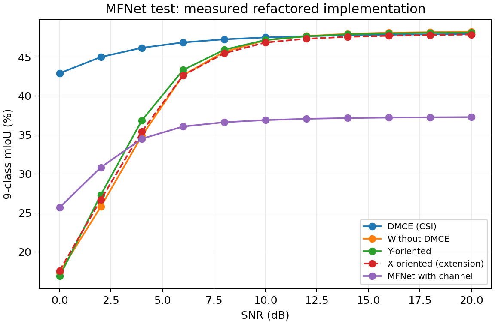
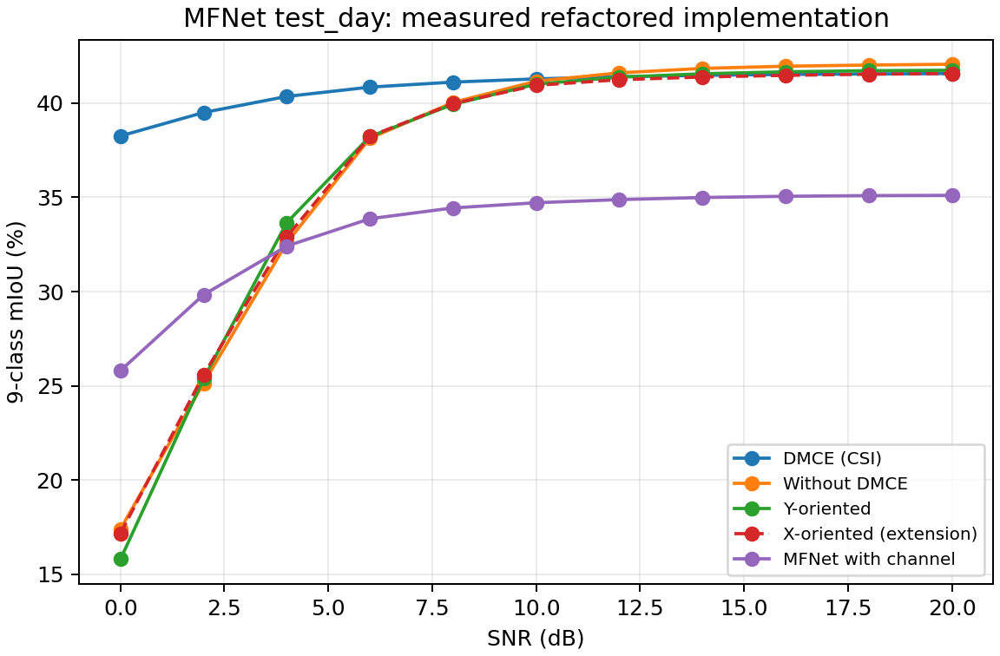
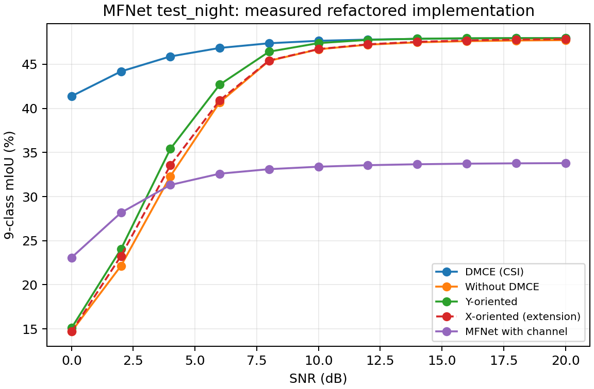
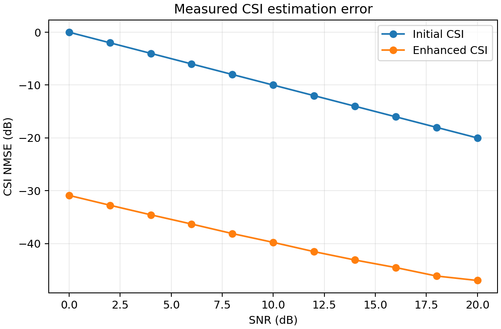
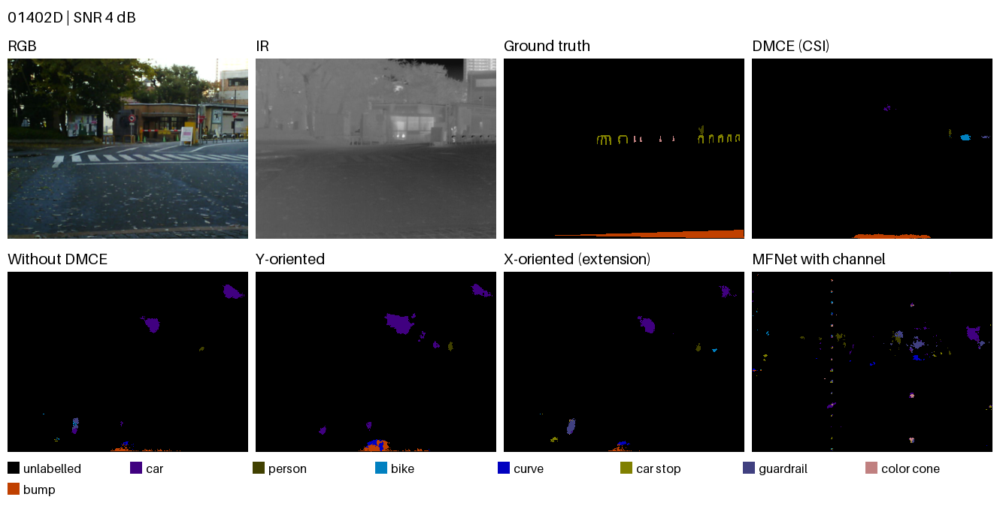
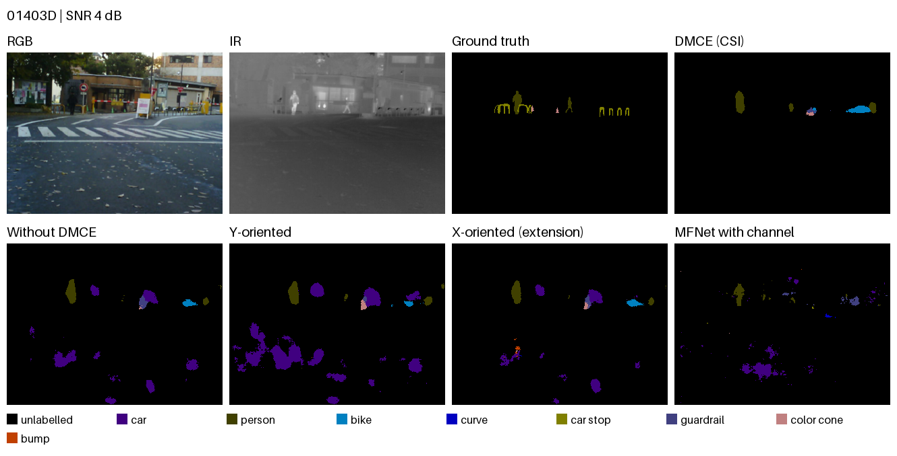
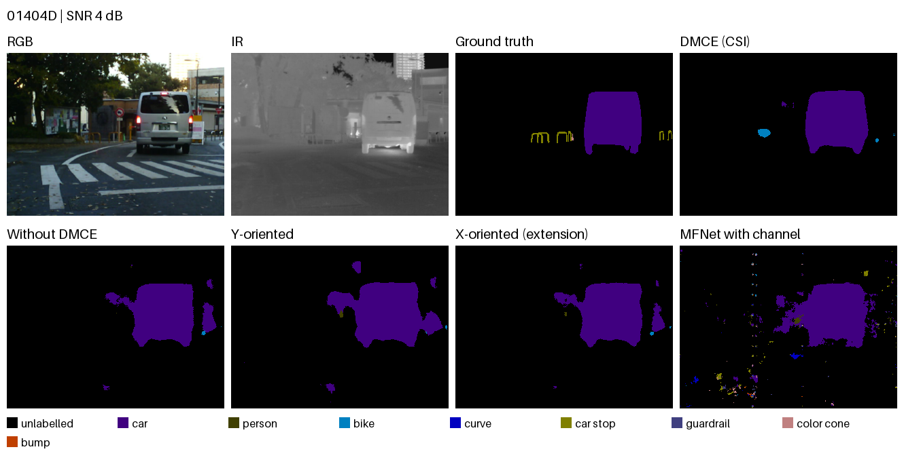
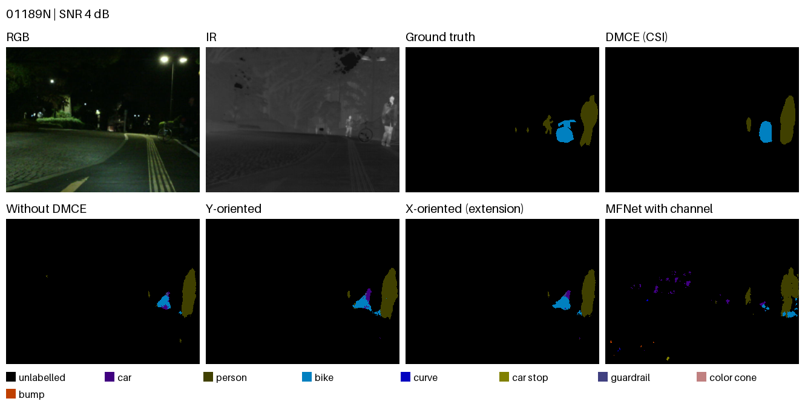
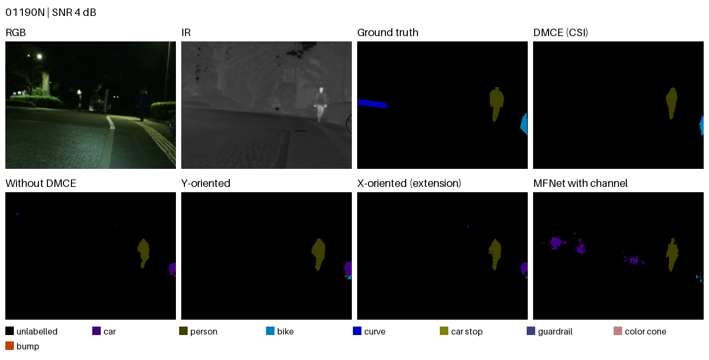

# 实测实验结果

[English](README.md) | [简体中文](README.zh-CN.md)

本报告由当前目录中的实测 JSON/CSV 自动生成。数值来自修复后的原实现，没有抄录 ICC 2024 论文的结果。

协议：`full_mfnet_100_epochs`；种子：**42**。测试场景共 **393** 个，其中白天 **205**、夜间 **188**。根据验证集选择权重，不用测试分数挑选模型。

本次为单种子实验，没有置信区间。实现保留简化的共享逐元素信道、合成扩散训练数据及确定性相邻时间步采样，因此不代表已恢复论文完整 MIMO 模型或其中的百分比增益。X-oriented 是原代码扩展。

完整测试集、昼间和夜间分别执行评测并重置随机种子，因此各次评测的信道抽样与 batch 平均噪声功率可能不同；昼夜混淆矩阵不是同一次完整测试推理的拆分。

## 完整测试集

九类 mIoU（%），包括背景类。

| SNR (dB) | DMCE (CSI) | Without DMCE | Y-oriented | X-oriented (extension) | MFNet with channel |
| --- | --- | --- | --- | --- | --- |
| 0 | 42.92 | 17.35 | 16.88 | 17.59 | 25.70 |
| 2 | 45.00 | 25.79 | 27.31 | 26.70 | 30.84 |
| 4 | 46.18 | 34.90 | 36.88 | 35.45 | 34.52 |
| 6 | 46.87 | 42.67 | 43.34 | 42.64 | 36.08 |
| 8 | 47.27 | 45.67 | 45.93 | 45.48 | 36.63 |
| 10 | 47.52 | 47.15 | 47.19 | 46.86 | 36.90 |
| 12 | 47.68 | 47.69 | 47.67 | 47.35 | 37.07 |
| 14 | 47.79 | 47.98 | 47.91 | 47.59 | 37.17 |
| 16 | 47.86 | 48.12 | 48.04 | 47.73 | 37.23 |
| 18 | 47.91 | 48.19 | 48.11 | 47.82 | 37.27 |
| 20 | 47.94 | 48.25 | 48.14 | 47.89 | 37.29 |

## 白天场景

九类 mIoU（%），包括背景类。

| SNR (dB) | DMCE (CSI) | Without DMCE | Y-oriented | X-oriented (extension) | MFNet with channel |
| --- | --- | --- | --- | --- | --- |
| 0 | 38.26 | 17.40 | 15.81 | 17.18 | 25.81 |
| 2 | 39.50 | 25.15 | 25.38 | 25.59 | 29.84 |
| 4 | 40.35 | 32.59 | 33.66 | 32.90 | 32.42 |
| 6 | 40.85 | 38.13 | 38.22 | 38.23 | 33.87 |
| 8 | 41.11 | 40.03 | 39.93 | 39.97 | 34.44 |
| 10 | 41.28 | 41.16 | 41.00 | 40.94 | 34.71 |
| 12 | 41.40 | 41.60 | 41.37 | 41.24 | 34.88 |
| 14 | 41.47 | 41.84 | 41.55 | 41.38 | 34.99 |
| 16 | 41.52 | 41.95 | 41.66 | 41.47 | 35.06 |
| 18 | 41.55 | 42.02 | 41.72 | 41.53 | 35.09 |
| 20 | 41.57 | 42.06 | 41.74 | 41.57 | 35.10 |

## 夜间场景

九类 mIoU（%），包括背景类。

| SNR (dB) | DMCE (CSI) | Without DMCE | Y-oriented | X-oriented (extension) | MFNet with channel |
| --- | --- | --- | --- | --- | --- |
| 0 | 41.39 | 14.71 | 15.10 | 14.69 | 23.09 |
| 2 | 44.19 | 22.14 | 24.04 | 23.26 | 28.17 |
| 4 | 45.89 | 32.31 | 35.41 | 33.53 | 31.32 |
| 6 | 46.86 | 40.69 | 42.70 | 40.92 | 32.60 |
| 8 | 47.39 | 45.39 | 46.43 | 45.43 | 33.11 |
| 10 | 47.67 | 46.71 | 47.40 | 46.73 | 33.39 |
| 12 | 47.80 | 47.23 | 47.77 | 47.27 | 33.56 |
| 14 | 47.89 | 47.49 | 47.90 | 47.55 | 33.67 |
| 16 | 47.93 | 47.63 | 47.96 | 47.71 | 33.73 |
| 18 | 47.95 | 47.70 | 47.97 | 47.81 | 33.77 |
| 20 | 47.96 | 47.74 | 47.96 | 47.86 | 33.79 |

本次 0 dB 下，DMCE 为 42.92%，Without-DMCE 为 17.35%，差值为 **+25.57 个百分点**。这是绝对差值，不是相对提升百分比。

## 4 dB 下的逐类 IoU

| 类别 | DMCE (CSI) | Without DMCE | Y-oriented | X-oriented (extension) | MFNet with channel |
| --- | --- | --- | --- | --- | --- |
| unlabelled | 97.36 | 96.33 | 96.12 | 96.41 | 95.96 |
| car | 82.21 | 69.19 | 65.35 | 70.32 | 59.65 |
| person | 58.08 | 41.56 | 43.88 | 40.88 | 54.50 |
| bike | 54.45 | 39.34 | 42.56 | 41.07 | 40.15 |
| curve | 30.48 | 13.71 | 21.14 | 14.77 | 20.73 |
| car stop | 21.23 | 9.67 | 11.41 | 11.74 | 8.14 |
| guardrail | 4.66 | 2.56 | 2.33 | 2.07 | 0.05 |
| color cone | 31.38 | 18.75 | 19.20 | 18.07 | 18.76 |
| bump | 35.79 | 22.98 | 29.93 | 23.75 | 12.74 |

## CSI NMSE

CSI 随机流：训练种子 **42**，验证种子 **100042**，测试种子 **200042**；每个 SNR 使用 **1000** 个合成测试信道。CSI 权重哈希记录在 results.json 中。

总误差功率 / 总真实信道功率，转为 dB；越低越好。

共享时延的信道化简为一个随机标量幅度的单一复指数。合成 CSI 的结构很强，此处结果不能外推为完整多用户 MIMO 的性能。

| SNR (dB) | 初始 CSI（dB） | 增强 CSI（dB） |
| --- | --- | --- |
| 0 | -0.000 | -30.878 |
| 2 | -2.000 | -32.736 |
| 4 | -4.000 | -34.545 |
| 6 | -6.000 | -36.293 |
| 8 | -8.000 | -38.100 |
| 10 | -10.000 | -39.762 |
| 12 | -12.000 | -41.517 |
| 14 | -14.000 | -43.097 |
| 16 | -16.000 | -44.525 |
| 18 | -18.000 | -46.131 |
| 20 | -20.000 | -46.972 |

## 推理耗时

设备：**NVIDIA RTX PRO 5000 72GB Blackwell**；精度：**float32**；batch size：**1**。每种方法、每个 SNR 预热 **2** 次，测量 **10** 次。同步计时覆盖全模型、信道及降噪，不含权重加载和数据读取；一个输入场景同时包含 RGB 与 IR。

| 方法 | SNR (dB) | 每 batch 中位耗时（ms） | 最小–最大（ms） | 每 batch UNet 调用中位数 |
| --- | --- | --- | --- | --- |
| DMCE (CSI) | 0 | 1556.03 | 1428.10–1768.18 | 198 |
| DMCE (CSI) | 4 | 1041.57 | 940.97–1198.72 | 131.5 |
| DMCE (CSI) | 10 | 526.90 | 472.27–613.76 | 66 |
| DMCE (CSI) | 20 | 153.65 | 136.30–181.31 | 18.5 |
| Without DMCE | 0 | 8.23 | 8.22–8.24 | 0 |
| Without DMCE | 4 | 8.22 | 8.21–8.23 | 0 |
| Without DMCE | 10 | 8.23 | 8.22–8.25 | 0 |
| Without DMCE | 20 | 8.23 | 8.22–8.24 | 0 |
| Y-oriented | 0 | 1574.37 | 1443.00–1781.98 | 198 |
| Y-oriented | 4 | 1050.91 | 952.90–1208.85 | 131.5 |
| Y-oriented | 10 | 532.01 | 476.80–619.86 | 66 |
| Y-oriented | 20 | 155.83 | 135.98–183.05 | 18.5 |
| X-oriented (extension) | 0 | 2055.62 | 1907.81–2295.21 | 260 |
| X-oriented (extension) | 4 | 1427.49 | 1300.55–1618.71 | 180 |
| X-oriented (extension) | 10 | 749.90 | 680.24–870.34 | 94 |
| X-oriented (extension) | 20 | 226.02 | 198.48–269.43 | 27.5 |
| MFNet with channel | 0 | 2.98 | 2.93–3.02 | 0 |
| MFNet with channel | 4 | 2.95 | 2.93–2.97 | 0 |
| MFNet with channel | 10 | 2.95 | 2.92–2.96 | 0 |
| MFNet with channel | 20 | 2.92 | 2.91–2.95 | 0 |

T=1000 是训练日程长度，实际逆扩散调用次数取决于观测噪声与起点。这些是当前基线的实测值；跳步 DDIM、DPM-Solver 与蒸馏仍为后续方向，此处没有宣称它们已经带来提速。

## 固定选取的定性示例

SNR：**4 dB**。按官方昼间、夜间列表的顺序选取，未根据模型输出挑选展示样本。样本 ID 和权重哈希记录在清单中。

## 训练完成情况与来源

| 阶段 | 完成轮数 | 最优轮次 | 验证指标 | 进程耗时（小时） |
| --- | --- | --- | --- | --- |
| shared_stage1 | 100 | 81 | mIoU 52.86% | 1.138 |
| mfnet_stage1 | 100 | 81 | mIoU 38.42% | 0.449 |
| dmce_stage2 | 100 | 100 | noise MSE 0.001149 | 1.630 |
| y_denoising_stage2 | 100 | 100 | noise MSE 0.132204 | 0.820 |
| x_denoising_stage2 | 100 | 100 | noise MSE 0.261524 | 0.824 |
| without_dmce_stage3 | 100 | 8 | mIoU 53.19% | 0.732 |
| dmce_stage3 | 100 | 18 | mIoU 53.34% | 1.852 |
| y_denoising_stage3 | 100 | 32 | mIoU 53.03% | 1.835 |
| x_denoising_stage3 | 100 | 18 | mIoU 53.24% | 2.374 |
| mfnet_channel_stage3 | 100 | 93 | mIoU 38.46% | 0.336 |

进程耗时为各任务的墙钟时间，并行任务不能直接相加作为整套实验历时；若发生续训，记录的是最近一次启动的历时，不包括先前尝试。接收端微调通过逐张量核对：编码器参数与 BatchNorm 缓冲保持不变，解码器权重有更新，扩散状态保持冻结。

| 方法 | 保持不变的编码器张量 | 更新的解码器权重张量 | 保持不变的扩散张量 |
| --- | --- | --- | --- |
| DMCE (CSI) | 657 | 34 | 478 |
| Without DMCE | 657 | 34 | 0 |
| Y-oriented | 657 | 34 | 478 |
| X-oriented (extension) | 657 | 34 | 478 |
| MFNet with channel | 238 | 16 | 0 |

运行库版本：torch `2.11.0a0+eb65b36914.nv26.2`, torchvision `0.25.0a0+1e53952f.nv26.2.44259020`, numpy `2.1.0`, Pillow `12.1.1`, matplotlib `3.10.8`.

原始报告保留实际研究配置、逐轮记录、权重 SHA-256、源码哈希、混淆矩阵与逐类指标。记录的训练模块 AST 对照全部通过；不包含私有路径或账号凭证。

## 机器可读数据

- [results.json](results.json)
- [segmentation.csv](segmentation.csv)
- [csi_nmse.csv](csi_nmse.csv)
- [latency.json](latency.json)
- [qualitative manifest](qualitative/manifest.json)
